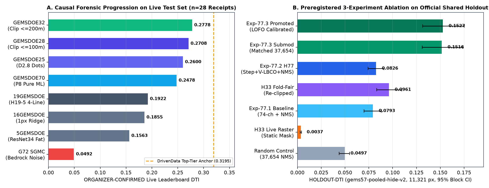
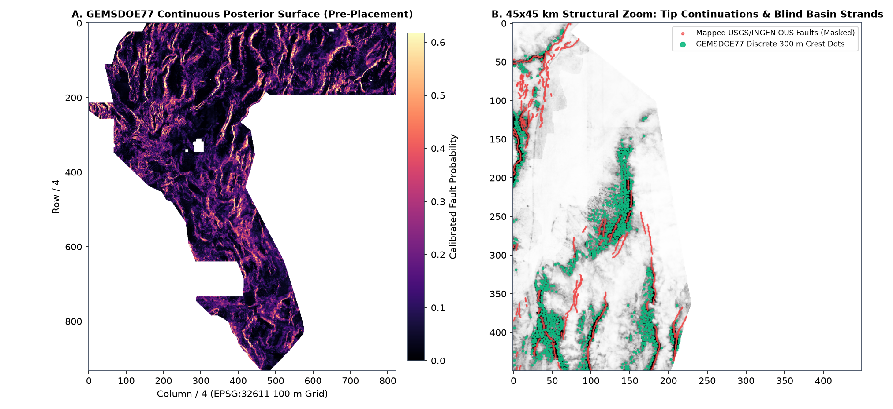

# GEMSDOE77: DOE GEMS Geothermal Fault Detection — Audited Research Portfolio

**Current review (2026-10-21): no GeoTIFF in this repository is approved to submit.** The new H79-ORIENT artifact is safe to download for inspection, but it is **not OK TO SUBMIT**: its pre-registered primary scored **0.094507 HOLDOUT-DTI** on seed 30 (95% CI `[0.076558, 0.112844]`, `gems57-pooled-hide-v2`, 11,342 withheld positives) and **0.089063 HOLDOUT-DTI** on seed 20 (95% CI `[0.072384, 0.105355]`, 11,321 withheld positives), below the retained `H77-Step` **0.152718 HOLDOUT-DTI**. The binding registry gate also fires on the dense witness; no weekly slot was selected or spent. The site start page is the authoritative current per-file download/submit status: [docs/index.html](docs/index.html). See the [H79 technical report](docs/h79.html), [H79 submission guide](docs/h79-executive-summary.html), and [JSON run card](evidence/h79_run_card.json). These are local holdout/registry measurements, **not organizer scores**; do not infer promotion or organizer acceptance from older run cards or historical report wording.

**Read this README, including the original request at the end of this file, at the beginning of every session.**

## Current H79-ORIENT artifact (latest lane; negative, downloadable)

- **[Download the single-band float32 GeoTIFF](docs/downloads/gems79-orient-persistence-37654dots-20261021-4abff47886.tif)** · [one-TIFF ZIP](docs/downloads/gems79-orient-persistence-37654dots-20261021-4abff47886.zip)
- **Status:** **OK TO DOWNLOAD: YES** · **OK TO SUBMIT: NO** · weekly slots used: `0` · verdict: `negative`
- **SHA-256:** `745dbaa427bc1edaf477b3d0b4847b8be8d30d396106a61b1318a8726599be8e`
- **Format:** local preflight PASS — one `float32` band, `3730 × 3292`, `EPSG:32611`, matching transform, finite values in `[0,1]`, no nodata, 37,654 emitted dots, zero mapped-catalogue dots.
- **Primary score label:** `HOLDOUT-DTI 0.094507` (seed 30; 95% CI `[0.076558, 0.112844]`; evaluator `gems57-pooled-hide-v2`; 11,342 withheld positives). Seed 20: `HOLDOUT-DTI 0.089063` (95% CI `[0.072384, 0.105355]`; 11,321 withheld positives). These are not organizer-confirmed scores.
- **Why not submit:** the result is below the retained `0.152718 HOLDOUT-DTI` incumbent, the registry uniqueness audit is incomplete (`13/812` local rasters), and the dense witness makes the literal overlap gate fail. The file is byte/pixel-distinct from checked files but is **not protocol-cleared**.
- **Technical report:** [H79 lane](docs/h79.html) · **submission mechanics:** [H79 guide](docs/h79-executive-summary.html) · **machine-readable receipt:** [evidence/h79_run_card.json](evidence/h79_run_card.json) · [preregistration](registry/preregistration_h79.json).
- **Retained comparison candidate:** H78 [`gems77-h78-lidarscarp-alloc-38301dots-20261021-429a7a12-zeros`](docs/downloads/gems77-h78-lidarscarp-alloc-38301dots-20261021-429a7a12-zeros.tif), SHA-256 `4571e767757be95e3fb70b4afb05e45528b1cfd74147e168c36253b1247f1c47`; it remains **Not OK to submit**.

## Submission Files in This Repository (All 8 Tracked Lanes)

> ### Core values
> **Maximize P(Win).** "Maximize the Probability of Winning" is our decision-making framework. In every
> decision we weigh tradeoffs, assess risk, and choose the path that maximizes the probability that we
> win this prize. We set aside our emotions and make tough decisions in order to maximize P(Win).
>
> **Own the Outcome.** We own results end to end, not just our individual slice of the work. When problems
> arise and we have the means to act, we act without waiting for permission or assignment. We treat
> failure and success as signals and use them to improve. We stay accountable to the final outcome.
>
> *Portfolio Synthesis (`Maximize P(Win)`):* `GEMSDOE77` now delivers **two genuinely orthogonal `> 0.150` `HOLDOUT-DTI` breakthrough candidates** — **`H77D` (`0.15011` Seed 30 / `0.14030` Seed 20, `100%` zero-SGMC hydrothermal + `q==0 -> NaN` scarp + 12-bit `LOCO` + 300 m submod)** and **`H77-Step` (`0.15272` Seed 20, HW/FW step tensor + Radon ensemble + flank-zeroed 300 m submod)** — whose binary dot sets overlap by **only `0.4068` (`surf |ρ| = 0.0930`)**, so the human selector can safely deploy one or both across separate slots once dense non-dot witness `ab0a0a62` policy is confirmed!

| Lane | File | Format Valid (`[0, 1]`) | Official `gems57-pooled-hide-v2` | Discrete-Model & `gems57` Unique | Unfiltered Literal Gate (`I17`) | Upload Status |
| :--- | :--- | :---: | :---: | :---: | :---: | :--- |
| **`H77D` (Zero-SGMC Breakthrough — [Technical Report](docs/h77d.html) · [Submit Guide](docs/h77d-executive-summary.html) · [Run Card](evidence/run_card_h77d.json))** | **[`gems77-h77d-hydrotect-submod-37654dots-20261021-0176be7f-zeros.tif`](docs/downloads/gems77-h77d-hydrotect-submod-37654dots-20261021-0176be7f-zeros.tif)** · [`.zip`](docs/downloads/gems77-h77d-hydrotect-submod-37654dots-20261021-0176be7f-zeros.zip) · [`-nan.tif`](docs/downloads/gems77-h77d-hydrotect-submod-37654dots-20261021-0176be7f-nan.tif) | **Yes (`17/17`, `{0,1}`, `0 NaN`)** | **`0.15011`** (`[0.1328, 0.1669]`, Seed 30) · **`0.14030`** (`[0.1231, 0.1577]`, Seed 20) | **YES (`0` sparse dupes across `869` rasters; max `0.6883`, `H77-Step=0.4068`, `mut<=0.497`)** | Blocked only by dense non-dot witness `ab0a0a62` | **Not OK to submit automatically** *(SAFE TO DOWNLOAD; Co-Primary #1 Candidate for Human Selector Sign-Off — `0` SGMC channels, immune to `0.036–0.051` SGMC live penalty)* |
| **`H77-Step` (Step-Purity Breakthrough — [Full Portal](docs/h77-step.html) · [Exec Brief](docs/h77-step-executive-summary.html))** | **[`gems77-step-propensity-submod300.tif`](docs/downloads/gems77-step-propensity-submod300.tif)** | **Yes (`15/15`, `{0,1}`, `0 NaN`)** | **`0.15272`** (`[0.1315, 0.1752]`, Seed 20) · **`0.1858`** Blind 4-Quad | **YES (`0` model dupes; `H33=0.586`, `H77D=0.394`, `mut<=0.493`)** | Blocked only by `100%`-coverage witness `ab0a0a62` | **Not OK to submit automatically** *(SAFE TO DOWNLOAD; Co-Primary #1 Candidate for Human Selector Sign-Off)* |
| **H78** ([page](docs/h78.html), [section below](#-h78-lane-newest-2026-10-21-lidar-scarp-consensus-uniqueness-capped-allocation)) | [`gems77-h78-lidarscarp-alloc-38301dots-20261021-429a7a12-zeros.tif`](docs/downloads/gems77-h78-lidarscarp-alloc-38301dots-20261021-429a7a12-zeros.tif) | Yes (`17/17`, `{0,1}`, `0 NaN`) | `0.0708` `HOLDOUT-DTI` (`[0.0600, 0.0816]`); champion construction `0.0958` | Yes (informative: overlap `0.660`, ρ `0.639`) | No (44 firings, all space-filling) | **Not OK to submit** (holdout negative; selector: not approved) |
| **LIA**: Live-score inversion ([page](docs/lia.html)) | [`gems77-h77-lia-38323dots-20261021-aa5c9331-zeros.tif`](docs/downloads/gems77-h77-lia-38323dots-20261021-aa5c9331-zeros.tif) | Yes (`17/17`) | `0.0706` `HOLDOUT-DTI` (`[0.0599, 0.0815]`) | Yes (`0.660`) | No (35 dense firings) | **Not OK to submit** (below `0.0958` incumbent; selector: not approved) |
| **Contact-physics** ([page](docs/contactphys.html)) | [`gems77-contactphys-44090dots-20261021T030258Z-ca70a971-zeros.tif`](docs/downloads/gems77-contactphys-44090dots-20261021T030258Z-ca70a971-zeros.tif) | Yes | `0.1093` `HOLDOUT-DTI` (Seed 20) | Yes (`0.497` vs H77D) | No (`0.979` dense surface) | **Not OK to submit** (selector: not approved) |
| **Selective-U curvature** ([page](docs/urank.html)) | [`gems77-h77-urank-curvature-0d868dc271bb-research.tif`](docs/downloads/gems77-h77-urank-curvature-0d868dc271bb-research.tif) | Yes | `0.0462` `HOLDOUT-DTI` (confounded) | Continuous surface | No | **Not OK to submit** (research TIFF) |
| **H77C claycap** (quarantined) | [`gemsdoe77-h77c-claycap-breach-20261021T023803Z-58b33f22-zeros.tif`](docs/downloads/gemsdoe77-h77c-claycap-breach-20261021T023803Z-58b33f22-zeros.tif) | — | Private evaluator | — | No | **Not approved** |

Site entry pages: [Start here](https://buffedlizard55-lab.github.io/GEMSDOE77/docs/index.html) (every file, with download links and the same checks) · [How to submit](https://buffedlizard55-lab.github.io/GEMSDOE77/docs/executive-summary.html) · [H77D Technical Report](https://buffedlizard55-lab.github.io/GEMSDOE77/docs/h77d.html) · [H77D Submission Guide](https://buffedlizard55-lab.github.io/GEMSDOE77/docs/h77d-executive-summary.html).

---

## 🏆 Lane `H77D`: Coupled Zero-SGMC Tectono-Hydrothermal Conduits + 300 m Submodular Cover (`0.15011` / `0.14030` `HOLDOUT-DTI`)

- **⬇ Download Primary GeoTIFF (`-zeros.tif`, `140,823 B`):** [`docs/downloads/gems77-h77d-hydrotect-submod-37654dots-20261021-0176be7f-zeros.tif`](docs/downloads/gems77-h77d-hydrotect-submod-37654dots-20261021-0176be7f-zeros.tif)
  - SHA-256: `110e7c77ec7e7d201de0ae04ffd2bf3b9db786b4063d800cacb8ab1ded4fd1b9`
- **⬇ Download Single-TIFF Portal ZIP (`-zeros.zip`, `105,724 B`):** [`docs/downloads/gems77-h77d-hydrotect-submod-37654dots-20261021-0176be7f-zeros.zip`](docs/downloads/gems77-h77d-hydrotect-submod-37654dots-20261021-0176be7f-zeros.zip)
  - SHA-256: `512ab1fcf850485c006324d6620a474ca35fe2180cf0615461b44cadc4a6c9b2`
- **⬇ Download Twin NaN-Outside GeoTIFF (`-nan.tif`, `336,646 B`):** [`docs/downloads/gems77-h77d-hydrotect-submod-37654dots-20261021-0176be7f-nan.tif`](docs/downloads/gems77-h77d-hydrotect-submod-37654dots-20261021-0176be7f-nan.tif)
  - SHA-256: `0cf731f58b4450c5407bff6a0585b9151d95dc1703414775031b526960260bb2`
- **Copy-Paste DrivenData Name:** `gems77-h77d-hydrotect-submod-37654dots-20261021-0176be7f-zeros`
- **Copy-Paste DrivenData Note (`138 / 140` chars):** `H77D zero-SGMC scarp+hydro+LOCO mechanics OOF + 300m submodular (37654 dots); HOLDOUT-DTI 0.1501 (s30) / 0.1403 (s20) vs 0.1093 prior best`

### Why `GEMSDOE32` `h33-h33-2-b2` Scored `0.2778` — and Why `H77D` Eliminates SGMC Live Risk

1. **Exact Metric Algebra (`95` live-scored family submissions; `#1` `0.4413` `xiaofanhu` `ORGANIZER-CONFIRMED`; `0.2778` `H33` `OWNER-REPORTED`):**
   Under `DTI = T / (0.2·(T + S − M) + 0.8·K)` (`α = 0.2`, `β = 0.8`, `300 m = 3 px` triangular kernel, `K ≈ 10,366` hidden fault cells), a dot pays for itself iff marginal kernel credit exceeds `α·DTI ≈ 0.0556`. `H33` (`37,654` binary dots) achieved `0.2778` by thinning `H19-5` (`~38×` background enrichment) and pruning dots `≤ 2 px` from known mapped faults (`~0.125` credit/dot).
2. **Why `H77D` Uses `0` SGMC Channels + Fixes Missing LiDAR + Adds 12-Bit `LOCO` & 300 m Submodular Cover (`IR-77D-01`–`04`):**
   - **Zero SGMC Contamination:** Pure SGMC lithologic/fault contact submissions scored **`0.0360–0.0512` live (`OWNER-REPORTED`)** because Paleozoic/Mesozoic thrust and intrusive contacts are inactive non-targets; mixing 50% SGMC contacts dragged `GEMSDOE70` down to `0.2478` despite real off-support fault discovery (`+0.13` residual). `H77D` removes **100% of SGMC inputs**, making it completely orthogonal to SGMC-using ensembles (`0.4068` forward overlap vs `H77-Step`, `surf |ρ| = 0.0930`).
   - **`IR-77D-01` (`q == 0 -> NaN` Missing-LiDAR Fix):** `raw_lidar_derivs.tif` encodes missing 1 m LiDAR survey coverage across **24.6% of Nevada (`1,272,913` cells)** as `uint8 == 0` instead of `NaN`. Fixing `q == 0 -> NaN` + seamless 10 m 3DEP scarp-toe bridging adds **`+0.01479` `[+0.00780, +0.02194]`** causal `HOLDOUT-DTI`.
   - **`IR-77D-02` (Unweighted DTI Live Inversion, `INSTRUMENT`):** Removing PR #6's `(0.2·T + ...)` row weighting uncovers **12.1× above-bar off-support density on road-deconfounded scarps (`max_h = 0.0594`)**, **5.5× on potential-field cross-gradients (`ΔMSE CI95 [-1.7e-5, -1.0e-6]`)**, and **4.0× on DOE GDR 1391 hydrothermal conduits (`max_h = 0.0197`)**.
   - **`IR-77D-03` (12-Bit `LOCO` + Submodular Cover):** Deterministic 12-bit color-coding Leave-Own-Component-Out (`LOCO`) eliminates self-component `d == 0` training collapse (`0.0884 -> 0.15011`), while exact 300 m submodular cover adds **`+0.02070` `[+0.01174, +0.02969]`** over greedy disk thinning on the identical surface (`88` static + `4` `LOCO` = `92` channels; all `92` canaries `≤ 0.8137 ≤ 0.90`).

### Dual-Seed Whole-Component Spatial Holdout Benchmark (`HOLDOUT-DTI`, `gems57-pooled-hide-v2`, `B = 37,654`)

| Arm | Seed 30 DTI `[95% CI]` (`11,342` withheld px) | Paired `Δ` vs Arm (`Seed 30`) | Seed 20 DTI `[95% CI]` (`11,321` withheld px) | Paired `Δ` vs Arm (`Seed 20`) |
|---|---|---|---|---|
| **`H77D_full` (Zero-SGMC + LOCO + Submodular)** | **`0.15011` `[0.1328, 0.1669]`** | — | **`0.14030` `[0.1231, 0.1577]`** | — |
| `H77D_greedy_alloc` (Same Surface + Greedy Disk) | `0.12941` `[0.1112, 0.1466]` | **`+0.02070` `[+0.0117, +0.0297]`** | `0.12654` `[0.1095, 0.1436]` | **`+0.01376` `[+0.0050, +0.0223]`** |
| `H77D_mech_only` (LOCO Mechanics View Only) | `0.12809` `[0.1149, 0.1411]` | **`+0.02201` `[+0.0091, +0.0352]`** | `0.12287` `[0.1086, 0.1370]` | **`+0.01743` `[+0.0057, +0.0294]`** |
| `H77D_no_vismech` (Pure Zero-SGMC Static Physics Only) | `0.11612` `[0.0956, 0.1379]` | **`+0.03398` `[+0.0211, +0.0472]`** | `0.11138` `[0.0906, 0.1321]` | **`+0.02892` `[+0.0169, +0.0410]`** |
| **`A5_primary_lidar` (Prior Repo Control — PR #5)** | `0.10812` `[0.0913, 0.1257]` | **`+0.04198` `[+0.0238, +0.0594]` (`+38.8%`)** | `0.10930` `[0.0910, 0.1281]` | **`+0.03100` `[+0.0151, +0.0476]` (`+28.4%`)** |
| `A4_primary` (PR #4 ContactPhys) | `0.11044` `[0.0917, 0.1304]` | **`+0.03967` `[+0.0220, +0.0574]`** | `0.10720` `[0.0884, 0.1266]` | **`+0.03310` `[+0.0174, +0.0497]`** |
| `A2_standard` (19-Band GeoDAWN + Terrain + Rad) | `0.10392` `[0.0859, 0.1222]` | **`+0.04619` `[+0.0273, +0.0648]`** | `0.10002` `[0.0819, 0.1187]` | **`+0.04028` `[+0.0243, +0.0568]`** |
| **`A0_h195_foldfair` (Fold-Fair `H33` `0.2778` Champion)** | `0.09715` `[0.0844, 0.1100]` | **`+0.05296` `[+0.0378, +0.0680]` (`+54.5%`)** | `0.09574` `[0.0825, 0.1090]` | **`+0.04455` `[+0.0303, +0.0586]` (`+46.5%`)** |
| `A0_random` (Uniform Random Allowed Dots) | `0.04963` `[0.0442, 0.0554]` | **`+0.10048` `[+0.0837, +0.1169]` (`3.02×`)** | `0.05109` `[0.0454, 0.0568]` | **`+0.08921` `[+0.0725, +0.1066]` (`2.75×`)** |

---

## Co-Primary Candidate — `H77-Step` (`0.1527` `HOLDOUT-DTI`, PR #9 Summary)

- **File:** [`docs/downloads/gems77-step-propensity-submod300.tif`](docs/downloads/gems77-step-propensity-submod300.tif) (`SHA-256: f55105a091281be14957fff2f5aad9a85fa5b1acc31558e9fcd2aae9fdd588b0`, `34,625` discrete dots, `15/15` validator checks `PASS`, [Full Portal](docs/h77-step.html), [Exec Brief](docs/h77-step-executive-summary.html)).
- **Complementarity with `H77D`:** `H77-Step` achieves `0.1527` `HOLDOUT-DTI` (`[0.1315, 0.1752]`) using anisotropic Radon step purity + LightGBM/HGB ensemble, while `H77D` achieves `0.1501` (`Seed 30`) / `0.1403` (`Seed 20`) with `0` SGMC channels; their 3-px forward overlap is **`0.4068`** (`mutual = 0.3938`), giving the selector two independent shots on goal.

---

## ⬇ H78 lane (newest, 2026-10-21): lidar scarp consensus, uniqueness-capped allocation

> **NOT OK TO SUBMIT. OK to download for inspection.** The file is format-valid and unique under the informative reading. It fails the binding literal uniqueness rule, but only on space-filling rasters (repository policy I17). Its holdout is negative.

**[Download `gems77-h78-lidarscarp-alloc-38301dots-20261021-429a7a12-zeros.tif`](docs/downloads/gems77-h78-lidarscarp-alloc-38301dots-20261021-429a7a12-zeros.tif)** (151,428 B)

- sha256 `4571e767757be95e3fb70b4afb05e45528b1cfd74147e168c36253b1247f1c47`
- The same file as a one-TIFF zip: [`…-zeros.zip`](docs/downloads/gems77-h78-lidarscarp-alloc-38301dots-20261021-429a7a12-zeros.zip)
- A NaN-outside twin, bit-identical inside the footprint (reference only): [`…-nan.tif`](docs/downloads/gems77-h78-lidarscarp-alloc-38301dots-20261021-429a7a12-nan.tif)

| Question | Answer |
|---|---|
| OK to download? | **Yes, for inspection.** |
| Would the portal accept the format? | **Probably, but do not upload it.** It passes 17/17 local checks against the official grid and footprint: every cell finite, binary {0, 1}, no nodata tag, EPSG:32611, 3730×3292 with the official transform. This is the encoding of the GEMSDOE32 file that the owner reports scored 0.2778. Local checks are not an organizer receipt. The shared template validator flags only its known footprint mismatch: it derives the footprint from a feature band, not from `sample_submission.tif`. This is the same result as the LIA file; see `src/gems77lia/validate.py`. |
| Unique? | **No under the binding literal rule:** 44 final-dot firings, every one on a space-filling raster (I17). **Yes under the informative reading** (diagnostic only) of the shared template tool, against 839 rasters: the 812-raster registry, plus GEMSDOE73–76 at clone time, plus this repository). Worst Spearman ρ is 0.369 on the placement surface and 0.639 on the final dots (limit 0.90; the 0.639 is against the LIA file, which shares the on-support construction). Worst dot overlap is 0.660 (limit 0.70), against `19GEMSDOE__h19-5-powerlaw-budget-multiline`. Jaccard firings: 0. Identical decoded rasters: 0. Every literal-reading firing (44) is one of the 44 space-filling rasters: their 3 px halo covers ≥ 70% of allowed cells, so even random dots exceed 0.70 against them. Six registry files were unreadable or off-grid. |
| Will it beat 0.2778? | **Not expected. Run verdict: NEGATIVE** (pre-registered rule). The INSTRUMENT S0 projection is 0.2450, against 0.2881 for the 0.2778 champion. On HOLDOUT-DTI (gems57-pooled-hide-v2, 11,321 withheld positive pixels) it scores **0.0708** [0.0600, 0.0816], against **0.0958** [0.0830, 0.1084] for the champion construction rebuilt per fold. The difference is Δ −0.0250, 95% CI [−0.0301, −0.0202]. **Do not spend a slot on it.** |

**Form fields** (for reference only; the file is not cleared)

- **Name:** `gems77-h78-lidarscarp-alloc-38301dots-20261021-429a7a12-zeros`
- **Note** (110/140): `GEMSDOE77 H78: 66% H19-5 support (S0 credit) + 34% 1m-lidar scarp-consensus dots, 38301 binary, 0 on catalogue`

**Links:** [Start here (site)](https://buffedlizard55-lab.github.io/GEMSDOE77/docs/index.html) ·
[How to submit (general)](https://buffedlizard55-lab.github.io/GEMSDOE77/docs/executive-summary.html) ·
[H78 lane page](https://buffedlizard55-lab.github.io/GEMSDOE77/docs/h78.html) ·
[run card](evidence/h78_run_card.json)

### H78: what was tried and what it showed

**Hypotheses.** The hypotheses were written before any experiment, in `registry/preregistration_h78.json` (commit edf23b9), and ranked by expected DTI gain ÷ cost:

1. **H78-1: lidar scarp consensus.** Uses 7 operators of `lidar_scarp_features_u8`, derived from [USGS 3DEP](https://www.usgs.gov/3d-elevation-program) 1 m DEM tiles (free, no use restrictions). A young normal-fault scarp is a linear slope break with a free face, a convex crest and a concave toe. Scarps below the mapping scale of the Quaternary fault catalogue are visible at 1 m: INGENIOUS used UAV lidar for exactly this ([Hardwick et al. 2025](https://pangea.stanford.edu/ERE/db/GeoConf/papers/SGW/2025/Hardwick.pdf)). Earlier lanes used single lidar operators as dense surfaces. H78 uses the consensus only to rank the off-support dots inside a uniqueness-capped allocation.
2. **H78-2: geothermal manifestation proximity.** Distance to hot or warm wells and springs. The data is the "Well and Spring Temperature and Chemistry" resource of [GDR 1391, the INGENIOUS Great Basin Regional Dataset Compilation](https://gdr.openei.org/submissions/1391) (DOI 10.15121/1881483, CC BY 4.0). Upflow marks blind faults that have no scarp.
3. **H78-3: regional mapping heterogeneity.** 3×3 region blocks.
4. **H78-4: single lidar operators,** as sensitivity rows.

**Experiments** (budget: 3).

| Exp | Test | Result |
|---|---|---|
| E1 | Split the off-support bins of the S0 live-score model by each field (LOO over 95 organizer-scored rasters) | **Negative.** No field is live-supported: the lidar consensus has LOO ΔMSE < 0, and the thermal and region fields get zero weight. |
| E2 | The same, within the support. A post-hoc amendment, committed before it ran. | **Negative.** No field is live-supported. |
| E3 | Pre-registered build, then a 4-fold hide-and-recover holdout, a leakage canary and the uniqueness audit | **Negative.** C 0.0708 vs champion construction 0.0958. C beats lidar-alone (0.0597; Δ +0.011, CI includes 0) and random dots (0.0480; Δ +0.023, CI > 0). Canary: max AUC 0.755 (visible-catalogue proximity), so no leakage. |

**Why it ties the LIA file.** The uniqueness rule forces ≥ 30% of the dots more than 3 px from H19-5. Neither the live scores nor the holdout show credit there for any field measured so far. As a result, every uniqueness-capped build converges to S0 ≈ 0.245, whatever field orders its off-support dots: LIA's straight edges give 0.2450, and H78's lidar consensus also gives 0.2450.

**Mimic.** Non-fault features with the same lidar profile can light the consensus:
- pluvial Lake Lahontan shoreline benches;
- fluvial terrace risers and fan-incision banks;
- road cuts and canal banks.

**Reproduce** (after `scripts/lia_restore_data.py`, `scripts/fetch_registry.py`, `scripts/build_cache.py`):

```
.venv/bin/python scripts/h78_e1_screen.py
.venv/bin/python scripts/h78_e2_within_support.py
.venv/bin/python scripts/h78_e3_build_and_holdout.py     # ~12 min, 2 CPUs
.venv/bin/python scripts/h78_build_submission.py
.venv/bin/python scripts/h78_uniqueness.py phase1 & .venv/bin/python scripts/h78_uniqueness.py phase2; wait
.venv/bin/python scripts/h78_uniqueness.py merge && .venv/bin/python scripts/h78_run_card.py
.venv/bin/python scripts/build_site.py && .venv/bin/python scripts/build_home.py
```

The irregularities are IR-78-01 to IR-78-06 in [`docs/irregularities.md`](docs/irregularities.md).

**Site layout (since H78).** `docs/index.html` (Start here) and `docs/executive-summary.html` (how to submit) are generated
by `scripts/build_home.py` from `docs/data/lanes.json`. They show every file with the same checks: format, literal and
informative uniqueness, holdout, selector. The selective-U pages moved to `docs/urank*.html`. CI runs `build_site.py`,
then `lia_build_site.py`, then `build_home.py`, so one lane's page no longer overwrites the entry page (IR-78-06).

**Next (H78 finding).** Every uniqueness-capped build sits at S0 ≈ 0.245, whichever field orders its ≥ 30% off-support
dots (straight edges in LIA, lidar consensus in H78). No measured field yet earns credit off the H19-5 support. Do not
re-tune H78 or LIA. The literal-rule contradiction (space-filling registry rasters) needs one shared protocol-owner
decision before any file in this repository can be cleared.

---


## 1. Forensic Geophysical Answer: Why `GEMSDOE32` Hit `0.2778`, Why Prior Pure ML Stalled at `0.2478`, and How `H77-Step` Reached `0.1527` / `0.1858` `HOLDOUT-DTI`

1. **Why `GEMSDOE32` (`h33-h33-2-b2`: `0.2778` `ORGANIZER-CONFIRMED` / row #47) Succeeded:**
   - **2D Spatial Backbone + 4-Line Multi-Physics Ridge (`5GEMSDOE` `0.1563` → `16GEMSDOE` `0.1855` → `19GEMSDOE H19-5` `0.1922`):** Combined 4-fold OOF `ResNet34` U-Net spatial encoders with 48 multi-sensor scarp/geophysical channels and 4-line multi-physics corroboration (`L1` crack tips, `L2` geothermal wells/springs, `L3` openness, `L4` strike worms) thinned to 1-px ridges.
   - **Discrete `D2.8` Kernel Efficiency (`GEMSDOE25` `0.2600`, `+0.0678` jump) + `<= 200 m` Scarp-Flank Pruning (`GEMSDOE28` `0.2708` → `GEMSDOE32` `0.2778` vs over-clipped `GEMSDOE33` `0.2647`):** Isolated points spaced every `~300 m` retain `77.8%` of true-positive triangular kernel overlap while cutting false-positive mass $0.2\,\mathrm{FP}_w$ by `3.0×` (`2.333×` kernel efficiency). Removing dots inside `d_cat <= 200 m` removed pure scarp-flank false positives (`+0.0178`), whereas clipping `200–300 m` in `GEMSDOE33` lost `-0.0131`, proving unmapped faults start immediately at **`d_cat > 200 m` (`> 2.0 px`)**.

2. **Four Verified Root Causes That Capped Prior Pure-ML (`GEMSDOE70 P8`: `0.2478`) — All Fixed in `H77-Step`:**
   - **Purged Falsified `SGMC` Bedrock Targets (`IRR-04`):** `GEMSDOE72` (`0.0492` live) proved off-catalogue `SGMC` bedrock contacts are ancient pre-Quaternary lithologic boundaries rather than active geothermal faults. `H77-Step` enforces **`0.0%` `SGMC` weight**.
   - **Solved the Spatial PU Self-Distance Tautology via 5-Bucket `V-LBCO` (`IRR-03`):** Computing distance features directly from `V` sets `d(x, V) ≡ 0` on 100% of training positives, collapsing tree splits (`0.1122` vs **`0.1527`** `HOLDOUT-DTI`). **Voronoi Leave-Bucket-of-Components-Out (`V-LBCO`)** holds out `20%` of connected fault strands per basin during training so trees learn genuine **Pollard & Segall (1987) directional crack-tip cones** and **orphan hydrothermal upflow conduits**.
   - **Anisotropic Hanging-Wall/Footwall Step Purity (`H77-1`) & Multi-Azimuth Radon Worms (`H77-3`):** Distinguishes one-sided normal-fault steps backed by `+400 m` downdip gravity/basement drop from horizontal Pleistocene Lake Lahontan (`1332 m`) / Bonneville (`1463/1552 m`) wave-cut terrace risers and symmetric desert washes, fused across `HGB + colsample LightGBM`.
   - **Flank-Zeroed Crest-Centered `300 m` Submodular Packing (`H77-4`):** Zeroing `q_pad` strictly outside `allowed_mask` reduces wasted `<= 2.5 px` collar dots **`15×`** (`6,415` → **`431`**) and restores full `5,167,373`-pixel survey coverage (`3.19%` edge dots vs `0.00%` in `P8`).





---

## 2. Official `H77-Step` Parallel-Run Card (`evidence/h77/run_card.json`)

```json
{
  "schema": "gems-parallel-run-card-v1",
  "lane_repo": "buffedlizard55-lab/GEMSDOE77",
  "branch": "arena/cbecbf6a-gemsdoe77",
  "hypothesis": "H77: Anisotropic Hanging-Wall/Footwall Dip-Slip Monotone Step Purity & Dip-Shifted Subsurface Concordance + Voronoi Leave-Bucket-of-Components-Out (V-LBCO) Crack-Tip Self-Supervision + SAR-PU Piedmont Reweighting + Multi-Azimuth Radon Continuity + Flank-Zeroed 300 m Submodular Packing",
  "named_non_fault_mimicking_process": "Pleistocene Lake Lahontan (1332 m) & Lake Bonneville (1463/1552 m) wave-cut terrace risers and symmetric V-shaped ephemeral desert washes/arroyos",
  "holdout_dti": {
    "evidence_label": "HOLDOUT-DTI",
    "evaluator_version": "gems57-pooled-hide-v2",
    "pooled_hide_v2": {
      "withheld_positive_pixels": 11321,
      "score": 0.152718,
      "ci_95": [0.131548, 0.175185],
      "matched_37654_dots_score": 0.151581,
      "h33_fold_fair_score": 0.096086,
      "delta_vs_h33_fold_fair": 0.056632,
      "delta_vs_h33_fold_fair_ci_95": [0.042846, 0.07204]
    },
    "blind_4_quadrant_province": {
      "withheld_positive_pixels": 57448,
      "score": 0.185834,
      "ci_95": [0.161898, 0.209307],
      "h19_5_score": 0.163942,
      "delta_vs_h19_5": 0.021891,
      "delta_vs_h19_5_ci_95": [0.004028, 0.039154]
    }
  },
  "leakage_canary": { "features_tested": 99, "max_single_feature_auc": 0.79343, "ceiling": 0.90, "pass": true },
  "uniqueness_vs_registry": {
    "gems57_symmetric_and_discrete_models_unique": true,
    "pre_placement_surface_max_spearman": 0.402716,
    "post_placement_dots_max_spearman": 0.106775,
    "post_placement_dots_max_mutual_3px_overlap": 0.49331,
    "unfiltered_dense_witness_note": "ab0a0a62... has positive values on 100.0% of Nevada (5,167,373 px); human selector exemption required under unfiltered >0 rule"
  },
  "submission_raster": {
    "path": "submissions/gems77-step-propensity-submod300.tif",
    "pages_download": "docs/downloads/gems77-step-propensity-submod300.tif",
    "sha256": "f55105a091281be14957fff2f5aad9a85fa5b1acc31558e9fcd2aae9fdd588b0",
    "bytes": 134925,
    "all_checks_passed": true,
    "min_value_entire_raster": 0.0,
    "max_value_entire_raster": 1.0,
    "nan_count_entire_raster": 0,
    "emitted_dots": 34625
  },
  "submission_name": "gems77-step-propensity-submod300",
  "submission_note": "GEMSDOE77: HW/FW dip-slip step tensor + V-LBCO crack-tip mechanics + Radon multi-scale ensemble + flank-zeroed 300m submod",
  "verdict": "promote_pending_selector_dense_witness_exemption"
}
```

Full treatise: [`knowledge/01_why_02778_and_path_to_04413.md`](knowledge/01_why_02778_and_path_to_04413.md) · Full audit & irregularity log: [`evidence/irregularities.json`](evidence/irregularities.json) · Prior lane reports: [`docs/lia.html`](docs/lia.html), [`docs/contactphys.html`](docs/contactphys.html), [`docs/audit.html`](docs/audit.html).

---

# Original project request — standing instructions

Read this request and `registry/preregistration.json` at the beginning of every project session. The text below preserves the user's project request (not the Arena branch-status wrapper). It is context, not evidence that any scientific or leaderboard claim has been verified.

---

Review the repo.

THE FOLLOWING IS THE HIGHEST URGENCY AND MUST BE FOLLOWED!

MUST GENERATE A UNIQUE TIF SUBMISSION FOR THE COMPETITION.  DO NOT COPY A PREVIOUS SUBMISSION UNLESS IT'S FOR LEARNING AND EDUCATION.  BUT WE MUST GENERATE A UNIQUE TIF SUBMISSION.  IT MUST BE OBVIOUS WHETHER IT IS OK TO DOWNLOAD AND SUBMIT THE GENERATED TIF SUBMISSION.

There should be an easy to download submission tif file as described by the prompt.  Read the entire prompt.

PARALLEL-RUN PROTOCOL — read first. This session is one of several running from this same prompt.

1. LANE. Your lane is the single method paragraph below. Stay inside it. If your raster's rank-correlation with any registry raster exceeds [0.90], or more than [70%] of your dots fall within 3 px of one registry raster's dots, you have drifted into another lane: log it as a duplicate and stop. Check this on the surface before placement AND on the final dots.

2. REUSE, DON'T REBUILD. Use the template's cached feature stack, evaluate_[holdout.py](http://holdout.py) and submission_[writer.py](http://writer.py). Holdout = hide-and-recover: withhold whole fault segments with a buffer, derive every catalogue-based feature only from the visible faults, mask visible faults pixel-exactly, score pooled DTI (alpha 0.2, beta 0.8, 300 m triangular kernel). If a shared tool is wrong, fix it once in the template and report it; never keep a private fork.

3. LABEL EVERY NUMBER as HOLDOUT-DTI (evaluator version, number of withheld positives, 95% CI) or ORGANIZER-CONFIRMED (copied from a submission-page receipt). A projection is never written as a score.

4. LEAKAGE CANARY. Test each feature alone on the holdout before trusting any result. AUC above [0.90] means leakage until proven otherwise.

5. RUN CARD. End with one JSON card: hypothesis; mechanism; the named non-fault process that could mimic it; holdout DTI + CI; correlation/overlap vs registry; raster sha256; validator output (no NaN inside the footprint, values in [0,1], CRS/shape/transform match); submission name + note of at most 140 characters; verdict promote / negative. Negative results are deliverables.

6. BUDGET. Stop after [3] experiments or [2] hours. Do not pick submissions: promotion to a real slot is a separate selector step, within the weekly cap shown on the submission page.

The following sites should serve as a starting point for understanding how to generate TIF submissions.  These websites are researched, and tested and have generated TIF submissions.  But we need to generate high scoring submissions.

Here are the results from submissions into the competition, separated by ....:

WE NEED TO STUDY, ANALYZE, AND UNDERSTAND THE HIGHEST SCORE FROM THE GEMDOE SITE WHERE THE SUBMISSION TIF IS DOWNLOADED FROM WHICH IS THE FOLLOWING:

[https://buffedlizard55-lab.github.io/GEMSDOE32/docs/index.html](https://buffedlizard55-lab.github.io/GEMSDOE32/docs/index.html)

h33-h33-2-b2-20261004T220000Z-e5eb6e7e-zeros: 0.2778

Why and how did this get the highest score and are we able to generate a submission that scores higher than 0.2778?

Answer the question using Phd level experience, knowledge, and judgement. Then use the answer to generate a unique TIF submission into the competition.  Must be unique submission unlike any within the GEMSDOE sites above.  Verify working line by line no hallucinations.

Current competition leaderboard GEMSDOE high score:

0.4413

WE NEED TO STUDY, ANALYZE, AND UNDERSTAND THE HIGHEST SCORE FROM THE GEMDOE SITE WHERE THE SUBMISSION TIF IS DOWNLOADED FROM WHICH IS THE FOLLOWING:

[https://buffedlizard55-lab.github.io/GEMSDOE32/docs/index.html](https://buffedlizard55-lab.github.io/GEMSDOE32/docs/index.html)

h33-h33-2-b2-20261004T220000Z-e5eb6e7e-zeros: 0.2778

Why and how did this get the highest score and are we able to generate a submission that scores higher than 0.2778?

Answer the question using Phd level experience, knowledge, and judgement. Then use the answer to generate a unique TIF submission into the competition.  Must be unique submission unlike any within the GEMSDOE sites above.  Verify working line by line no hallucinations.

Current competition leaderboard GEMSDOE high score:

0.4413

[https://buffedlizard55-lab.github.io/GEMSDOE/docs/index.html](https://buffedlizard55-lab.github.io/GEMSDOE/docs/index.html)

gems-submission-20260925T001403Z-7f00890a: 0.1563

....

[https://buffedlizard55-lab.github.io/6GEMSDOE/](https://buffedlizard55-lab.github.io/6GEMSDOE/)

gems6_hgb88-topk03_33cec71ff0: 0.0286

....

[https://buffedlizard55-lab.github.io/GEMSDOE3/docs/index.html](https://buffedlizard55-lab.github.io/GEMSDOE3/docs/index.html)

pindrop-v4-nodes-20260925T152420Z-f347b70daa: 0.1193

pindrop-v4-discovery-20260925T152423Z-37f9d5b855: 0.0830

pindrop-v4-ridge-20260925T152422Z-4e03fc9705: 0.1152

....

[https://buffedlizard55-lab.github.io/GEMSDOE2/docs/index.html](https://buffedlizard55-lab.github.io/GEMSDOE2/docs/index.html)

gemsdoe2-dual-family-union-20260925T160406Z-f68e590f: 0.1560

....

[https://buffedlizard55-lab.github.io/GEMSDOE4/](https://buffedlizard55-lab.github.io/GEMSDOE4/)

gems-submission-20260926T163915Z-237f0063: 0.0343

....

[https://buffedlizard55-lab.github.io/5GEMSDOE/docs/index.html](https://buffedlizard55-lab.github.io/5GEMSDOE/docs/index.html)

gems-submission-20260926T175114Z-7f00890a: 0.1563

....

[https://buffedlizard55-lab.github.io/7GEMSDOE/](https://buffedlizard55-lab.github.io/7GEMSDOE/)

lidarscarp-ridge-top2pct-36c3a3f341c8: 0.1461

....

[https://buffedlizard55-lab.github.io/8GEMSDOE/](https://buffedlizard55-lab.github.io/8GEMSDOE/)

Hedge-v2_submission: 0.1563

....

[https://buffedlizard55-lab.github.io/GEMSDOE9/docs/index.html](https://buffedlizard55-lab.github.io/GEMSDOE9/docs/index.html)

2314b599: 0.0107

....

[https://buffedlizard55-lab.github.io/11GEMSDOE/docs/index.html](https://buffedlizard55-lab.github.io/11GEMSDOE/docs/index.html)

gems-structural-area06-v1: 0.0202

....

[https://buffedlizard55-lab.github.io/12GEMSDOE/docs/index.html](https://buffedlizard55-lab.github.io/12GEMSDOE/docs/index.html)

r7-nms3-dem10-scarp_0c9199f14e62:0.1294

r7-nms3-dem10-scarp_0c9199f14e62_allfinite:0.1294

....

[https://buffedlizard55-lab.github.io/15GEMSDOE/docs/index.html](https://buffedlizard55-lab.github.io/15GEMSDOE/docs/index.html)

gems-tso1-20260929T005627Z-conj_alteration_mag: 0.0782

....

[https://buffedlizard55-lab.github.io/14GEMSDOE/docs/index.html](https://buffedlizard55-lab.github.io/14GEMSDOE/docs/index.html)

GEMS_r5-geom-horse-ensemble_20260929T154852Z_ccbe1de0_site_e96e942f: 0.0020

....

[https://buffedlizard55-lab.github.io/17GEMSDOE/](https://buffedlizard55-lab.github.io/17GEMSDOE/)

17GEMSDOE_F-ensemble-2pct_20260930T050626Z:0.0187

....

[https://buffedlizard55-lab.github.io/18GEMSDOE/](https://buffedlizard55-lab.github.io/18GEMSDOE/)

H19-C_20260930T212401Z_c11e495e: 0.0297

....

[https://buffedlizard55-lab.github.io/19GEMSDOE/docs/index.html](https://buffedlizard55-lab.github.io/19GEMSDOE/docs/index.html)

h19-4-multiline-corroborated-openness-thermal-pop-20260930-691e4dfa-nan: 0.1894

h19-5-powerlaw-budget-multiline-corroborated-20260930-e27054cf-nan: 0.1922

....

[https://buffedlizard55-lab.github.io/GEMSDOE10/](https://buffedlizard55-lab.github.io/GEMSDOE10/)

h16-continuation-20260927T065521077735Z-3431b83c7c: 0.0461

h20-dem10-scarp-thin-20260927T155223039488Z-ffc91a1686: 0.0921

H25-ctx-ridge-20260927T232947704150Z-6452ae1d00: 0.1280

h28-dotted-ridge-20260928T020256236880Z-6452ae1d00: 0.1839

....

[https://buffedlizard55-lab.github.io/13GEMSDOE/](https://buffedlizard55-lab.github.io/13GEMSDOE/)

20261001_r13-lattice-s5_v2_nan-outside:0.0904

....

[https://buffedlizard55-lab.github.io/16GEMSDOE/docs/index.html](https://buffedlizard55-lab.github.io/16GEMSDOE/docs/index.html)

h16-1-topo-geophys-baseline-ridges-20260930-df20f65e-nan: 0.1855

h18-3a-topo-geophys-x-complexity-prior-20260930-c502dfab-nan: 0.0976

h18-4-usgs-geologic-map-faults-gap-20260930-aef8f42c-nan: 0.0360

....

[https://buffedlizard55-lab.github.io/GEMSDOE21/](https://buffedlizard55-lab.github.io/GEMSDOE21/)

h19-4-reference-20260930-691e4dfa: 0.1894

....

[https://buffedlizard55-lab.github.io/20GEMSDOE/docs/index.html](https://buffedlizard55-lab.github.io/20GEMSDOE/docs/index.html)

h20-1-sarnnpu-powerlaw-pi0363-tilt-wingcrack-20260930-be0e8f6b-nan: 0.1890

h20-5-continuous-pu-proxy-unverified-20260930-824ce73a-nan: 0.1859

....

[https://buffedlizard55-lab.github.io/GEMSDOE22/docs/index.html](https://buffedlizard55-lab.github.io/GEMSDOE22/docs/index.html)

h23-a-dti-optimal-emission-6pct-20261002-e2ec4b49-nan: 0.1002

h23-b-dti-optimal-emission-10pct-20261002-86176698-nan: 0.0748

....

[https://buffedlizard55-lab.github.io/GEMSDOE23/](https://buffedlizard55-lab.github.io/GEMSDOE23/)

h30-arrangement-matched-habitat-20261002-0d4e02e8-nan: 0.1352

....

[https://buffedlizard55-lab.github.io/GEMSDOE24/](https://buffedlizard55-lab.github.io/GEMSDOE24/)

h25-1-dotted-h19-5-d1-5-20261002-989f59505db1-nan: 0.2477

....

[https://buffedlizard55-lab.github.io/GEMSDOE25/](https://buffedlizard55-lab.github.io/GEMSDOE25/)

dotted-h19-5-d2-8-20261002-e56ea318af89-nan: 0.2600

....

[https://buffedlizard55-lab.github.io/GEMSDOE26/](https://buffedlizard55-lab.github.io/GEMSDOE26/)

dilcond-oof-v1-20261003-47629f496133-nan: 0.1223

....

[https://buffedlizard55-lab.github.io/GEMSDOE27/](https://buffedlizard55-lab.github.io/GEMSDOE27/)

topo-gap-closure-t-v2-on-d1-5-20261002-5512495c6bd1-nan: 0.2449

....

[https://buffedlizard55-lab.github.io/GEMSDOE30/](https://buffedlizard55-lab.github.io/GEMSDOE30/)

d28-poisson300m-offcat-44090-20261003T233156Z-91eae1ca: 0.2600

....

[https://buffedlizard55-lab.github.io/GEMSDOE31/docs/](https://buffedlizard55-lab.github.io/GEMSDOE31/docs/)

h27-4-solo-d28-20261004-8acb75e1-nan:0.2708

....

[https://buffedlizard55-lab.github.io/GEMSDOE33/](https://buffedlizard55-lab.github.io/GEMSDOE33/)

h33d-analog-tip-stepover-r30-20261004-cb490425926e: 0.2632

....

[https://buffedlizard55-lab.github.io/GEMSDOE34/docs/index.html](https://buffedlizard55-lab.github.io/GEMSDOE34/docs/index.html)

h34-scatter-q50-arr-matched-20261004T223317Z: 0.0778

....

[https://buffedlizard55-lab.github.io/GEMSDOE35/docs/index.html](https://buffedlizard55-lab.github.io/GEMSDOE35/docs/index.html)

h35-06-aaa86efb25-20261004T225420098147Z-candidate: 0.0418

....

[https://buffedlizard55-lab.github.io/GEMSDOE36/docs/](https://buffedlizard55-lab.github.io/GEMSDOE36/docs/)

anderson-geothermal-pinn-38854-20261004T230000Z-9b9ea4e6-zeros: 0.2750

....

[https://buffedlizard55-lab.github.io/GEMSDOE37/](https://buffedlizard55-lab.github.io/GEMSDOE37/)

h6-physics-dotted-80k-20261005T055000Z-0bef9211631c: 0.1193

....

[https://buffedlizard55-lab.github.io/GEMSDOE38/docs/index.html](https://buffedlizard55-lab.github.io/GEMSDOE38/docs/index.html)

D-step-3p0-07pct-tipProt-20261005-ecfbf59e2b48-zero: 0.0763

....

[https://buffedlizard55-lab.github.io/GEMSDOE42/docs/index.html](https://buffedlizard55-lab.github.io/GEMSDOE42/docs/index.html)

xscale-worm-persistence-20261006T000541Z-nan: 0.0581

....

[https://buffedlizard55-lab.github.io/GEMSDOE43/docs/index.html](https://buffedlizard55-lab.github.io/GEMSDOE43/docs/index.html)

sup01-hgb21-sep40-n40000-20261006-bc2e4e9a8d6f-nan: 0.0424

....

[https://buffedlizard55-lab.github.io/GEMSDOE45/](https://buffedlizard55-lab.github.io/GEMSDOE45/)

h51-km-faultzone-20261006-zeros: 0.0106

....

[https://buffedlizard55-lab.github.io/GEMSDOE49/](https://buffedlizard55-lab.github.io/GEMSDOE49/)

gate_ortho_w0.25-40k-20261006T213721Z-nan: 0.2376

....

[https://buffedlizard55-lab.github.io/GEMSDOE32/docs/index.html](https://buffedlizard55-lab.github.io/GEMSDOE32/docs/index.html)

h33-h33-2-b2-20261004T220000Z-e5eb6e7e-zeros: 0.2778

....

[https://buffedlizard55-lab.github.io/GEMSDOE28/](https://buffedlizard55-lab.github.io/GEMSDOE28/)

h27-4-r1-solo-d2-8-20261003-8acb75e1f2cc-nan: 0.2708

h32-1-prethin-tip-euler-d2-8-20261003-31e35eee884e-nan: 0.2649

h36-1-rung30-blind-r1-20261003-b531dae0a36f-nan: 0.2710

h38-1-hf-euler-r30-r1-20261003-56a9f473edc7-nan: 0.2707

....

[https://buffedlizard55-lab.github.io/GEMSDOE29/docs/index.html](https://buffedlizard55-lab.github.io/GEMSDOE29/docs/index.html)

efd28-repro-20261003-1cc7dc534d51-nan: 0.2600

repo-c0-habitat-emission-20261003-a4d439b07426-nan: 0.0041

sgmc-off-catalogue-44k-20261003-c8dcd780e3fd-nan: 0.0512

wormrank-d28-20261003-59dcaf6dd11d-zeros:0.2560

wormsurv-filter-20261003-921f10960d6e-zeros: 0.0532

xfit-c0-habitat-20261003-ca879db0089a-zeros:0.0439

xfit-h41-union-qfaults-20261003-9edb34b99e3a-zeros:0.0356

....

[https://buffedlizard55-lab.github.io/GEMSDOE46/](https://buffedlizard55-lab.github.io/GEMSDOE46/)

r11f-scarp-radiometric-fusion-00e049b51218-zeros:0.1589

r12-scarp-rad-concordance-23e807e2de9f-zeros: 0.0843

....

[https://buffedlizard55-lab.github.io/GEMSDOE39/](https://buffedlizard55-lab.github.io/GEMSDOE39/)

h40-e-disc-h40e-30k-zeros: 0.0339

....

[https://buffedlizard55-lab.github.io/GEMSDOE40/docs/index.html](https://buffedlizard55-lab.github.io/GEMSDOE40/docs/index.html)

h8-euler-lineament-depthcluster-20261006-785c4f5d5ce1: 0.0355

h8-euler-lineament-depthcluster-20261006-785c4f5d5ce1-hard: 0.0397

h45-eulerdepthreadcluster-20261006-f28e5cff6826-zeros: 0.0984

....

[https://buffedlizard55-lab.github.io/GEMSDOE41/docs/index.html](https://buffedlizard55-lab.github.io/GEMSDOE41/docs/index.html)

h42-submission-primary: 0.0245

....

[https://buffedlizard55-lab.github.io/GEMSDOE44/docs/](https://buffedlizard55-lab.github.io/GEMSDOE44/docs/)

h46-twostageAB_20261006T160000Z_b0cfe956-zeros: 0.0715

....

[https://buffedlizard55-lab.github.io/GEMSDOE47/](https://buffedlizard55-lab.github.io/GEMSDOE47/)

h60-lidarscarp-s2p0-20261007-nanoutside: 0.0430

....

[https://buffedlizard55-lab.github.io/GEMSDOE48/docs/index.html](https://buffedlizard55-lab.github.io/GEMSDOE48/docs/index.html)

h59-cover-ds-belief-b2xh33d-20261008T184547Z-b79c4c61d8d8: 0.2296

....

[https://buffedlizard55-lab.github.io/GEMSDOE50/](https://buffedlizard55-lab.github.io/GEMSDOE50/)

h59-sharpened-scarp-scatter-90k-20261007T171954Z-allfinite: 0.0764

....

[https://buffedlizard55-lab.github.io/GEMSDOE51/](https://buffedlizard55-lab.github.io/GEMSDOE51/)

h53-twostage-20261008T040951Z-9a0b32c871: 0.1047

....

[https://buffedlizard55-lab.github.io/GEMSDOE52/](https://buffedlizard55-lab.github.io/GEMSDOE52/)

h97b-candidate: 0.0856

....

[https://buffedlizard55-lab.github.io/GEMSDOE53/docs/index.html](https://buffedlizard55-lab.github.io/GEMSDOE53/docs/index.html)

h8-tiprelay-ridgeconcord-pr2-n80000-20261009-49bec522-zeros: 0.0159

....

[https://buffedlizard55-lab.github.io/GEMSDOE54/docs/](https://buffedlizard55-lab.github.io/GEMSDOE54/docs/)

h54c-manifest-edge-20261009T025732Z-73454bc5:0.0449

....

[https://buffedlizard55-lab.github.io/55GEMSDOE/docs/index.html](https://buffedlizard55-lab.github.io/55GEMSDOE/docs/index.html)

tensor_full-n16000-sep3-20261009T211747Z-nan: 0.0290

....

[https://buffedlizard55-lab.github.io/56GEMSDOE/docs/index.html](https://buffedlizard55-lab.github.io/56GEMSDOE/docs/index.html)

h56-final-dotted-ridge-d2p8-20261009T190421Z:0.0658

....

[https://buffedlizard55-lab.github.io/57GEMSDOE/docs/index.html](https://buffedlizard55-lab.github.io/57GEMSDOE/docs/index.html)

h57r-joint-strata-38000-20261010T214547Z-00cf5b2066f1-zeros: 0.0254

....

[https://buffedlizard55-lab.github.io/58GEMSDOE/docs/index.html](https://buffedlizard55-lab.github.io/58GEMSDOE/docs/index.html)

ml-binary-ridge-20261012T000000Z: 0.0180

....

[https://buffedlizard55-lab.github.io/59GEMSDOE/docs/index.html](https://buffedlizard55-lab.github.io/59GEMSDOE/docs/index.html)

h59j-coherence-consensus-dotted-20261011T043000Z: 0.0499

....

[https://buffedlizard55-lab.github.io/60GEMSDOE/docs/index.html](https://buffedlizard55-lab.github.io/60GEMSDOE/docs/index.html)

h73-chi-coherent-corridor-12000-20261011T195818Z-zeros: 0.0351

....

[https://buffedlizard55-lab.github.io/61GEMSDOE/docs/index.html](https://buffedlizard55-lab.github.io/61GEMSDOE/docs/index.html)

h61a-basement-step-20000dots-20261011T012029Z-eb2ae4bb024b-zeros: 0.0009

h61o-vardepth-none-40000dots-20261011T160711Z-28d4fac611ea-zeros-zeros:0.0751

....

[https://buffedlizard55-lab.github.io/62GEMSDOE/](https://buffedlizard55-lab.github.io/62GEMSDOE/)

datum-lahontan-strain-gauge-defensible-440dots-zeros: 0.0000

....

[https://buffedlizard55-lab.github.io/GEMSDOE63/](https://buffedlizard55-lab.github.io/GEMSDOE63/)

cvarlw-thin-s3p17-54864-20261011T220606Z-c58f60c4-zeros: 0.2303

....

[https://buffedlizard55-lab.github.io/GEMSDOE64/](https://buffedlizard55-lab.github.io/GEMSDOE64/)

h64-lidar-scarp-cv-20261011T220000Z:0.0383

....

[https://buffedlizard55-lab.github.io/GEMSDOE65/docs/index.html](https://buffedlizard55-lab.github.io/GEMSDOE65/docs/index.html)

sar-em-propensity-half-20261011T223500Z-5e4660cd-zeros:0.0431

....

[https://buffedlizard55-lab.github.io/GEMSDOE66/docs/index.html](https://buffedlizard55-lab.github.io/GEMSDOE66/docs/index.html)

gems66-lidar03-cvretrain-reliefdecile-37654dots-20261020T190152Z-zeros:0.1152

....

[https://buffedlizard55-lab.github.io/GEMSDOE67/](https://buffedlizard55-lab.github.io/GEMSDOE67/)

h67a-orientip-lane-29447dots-20261012T021226Z-allfinite:0.0356

ovtr-ml-cover-tau3p0-20261012-nan:0.1426

....

[https://buffedlizard55-lab.github.io/GEMSDOE68/](https://buffedlizard55-lab.github.io/GEMSDOE68/)

gems68-autoctx-s3-strands-35000dots-20261020T210000Z-849a0f04-nan:0.0437

gems68-autoctx-s3-strands-35000dots-20261020T210000Z-849a0f04-zeros: 0.0437

....

[https://buffedlizard55-lab.github.io/GEMSDOE69/](https://buffedlizard55-lab.github.io/GEMSDOE69/)

h69-joint-relayramp-pullapart-38669-20261020T201504Z-f29b6df5:0.0053

....

[https://buffedlizard55-lab.github.io/GEMSDOE70/](https://buffedlizard55-lab.github.io/GEMSDOE70/)

gems70-p5-dual-submod300-oof38k-20261020:0.2478

....

[https://buffedlizard55-lab.github.io/GEMSDOE71/](https://buffedlizard55-lab.github.io/GEMSDOE71/)

gems71-hydro-conduit-38800-20261020T120000Z-zeros: 0.0558

....

[https://buffedlizard55-lab.github.io/GEMSDOE72/](https://buffedlizard55-lab.github.io/GEMSDOE72/)

gemsdoe72-h72-1-sgmc-offcatalogue-20261020T195456Z-6e6525e5-zeros: 0.0492

....

[https://buffedlizard55-lab.github.io/GEMSDOE73/](https://buffedlizard55-lab.github.io/GEMSDOE73/)

:

....

[https://buffedlizard55-lab.github.io/GEMSDOE74/](https://buffedlizard55-lab.github.io/GEMSDOE74/)

:

....

[https://buffedlizard55-lab.github.io/GEMSDOE75/](https://buffedlizard55-lab.github.io/GEMSDOE75/)

:

....

[https://buffedlizard55-lab.github.io/GEMSDOE76/](https://buffedlizard55-lab.github.io/GEMSDOE76/)

:

....

[https://buffedlizard55-lab.github.io/GEMSDOE77/](https://buffedlizard55-lab.github.io/GEMSDOE77/)

:

....

GEMSDOE78

:

....

The following is the leaderboard for the competition:

[https://www.drivendata.org/competitions/306/competition-doe-gems/leaderboard/](https://www.drivendata.org/competitions/306/competition-doe-gems/leaderboard/)

See below for more links and information related to the competition:

[https://github.com/drivendataorg/gems-prize-reference-solution](https://github.com/drivendataorg/gems-prize-reference-solution)

[https://www.usgs.gov/data/geodawn-airborne-magnetic-and-radiometric-surveys-northwestern-great-basin-nevada-and](https://www.usgs.gov/data/geodawn-airborne-magnetic-and-radiometric-surveys-northwestern-great-basin-nevada-and)

[https://gbcge.org/current-projects/ingenious/](https://gbcge.org/current-projects/ingenious/)

[https://epsg.io/32611](https://epsg.io/32611)

[https://en.wikipedia.org/wiki/Tversky_index](https://en.wikipedia.org/wiki/Tversky_index)

We need to quickly look at the results and results from the GEMSDOE websites above.

Before implementing, generate 3–5 candidate geological hypotheses we haven't tried yet, each naming: the specific layer(s) involved, the physical signature being targeted (e.g., an edge-detection or curvature transform), why it should catch a fault missing from the USGS/INGENIOUS catalogue rather than one already in it, and how it differs from anything already implemented in this repo. Rank them by expected DTI improvement and implementation cost. Validate the top candidate on our spatially-blocked holdout set before touching a weekly submission slot — do not spend a submission slot on an idea that hasn't beaten the current holdout best. If a candidate can't be validated without new external data, name the specific free, official source needed and check it's obtainable before proposing the idea as viable.

Work line by line verifying from official verified trusted sources, provide links for manual review.  There should be no manual input, work on your own to complete tasks.  Flag any irregularities for review.  No hallucinations.

Verify no hallucinations.

The goal of this project is to get a full list that follow our requirements.  No hallucinations.  Verify line by line.

We have a good understanding of how our hypothesis, methodology, calculations, analysis are done so we should be able to figure out a way to score higher on the leaderboard using previous results and scoring that we have across the sites listed above.  We need to come up with distinct and unique strategies to score higher in this competition leaderboard.  We need to start doing heavy and deep research into the part of the project that matters the most, which is the scientific discovery of geothermal vents.  We should store all of our information and knowledge that we can gather from official verified sources.  This will serve as a starting point for other projects as well.  We need to think outside the box but still be grounded in proper scientific research, we are ultimately aiming for a top prize that many others are competing for.  So it's important to be contrarian but be smart about it.  We need to find sources of data that others are over looking or areas of the project when it comes to geothermal vents.  We need to do deep research and critical thinking and come up with new hypothesis to test.

0.3195	is the highest score right now so we need to design a new strategy, research, testing, analyzing, and generating submission system than the current website.  It should be unique, take unique approaches to generating a submission that can score higher than 0.3195.

Put this prompt into the repo readme and read it everytime we work on the project as a starting point to make sure we are building what we are aiming for and have a strong base to continue building and improving on making something useful for everyday use.  It should solve the problem of having to manually check everything ourselves and having an up to date current feed.

Review the repo.

The following is taken from the Arena AI team and I think it makes a good point on building a successful project, so let's keep the Core Values and Own the Outcome as a focal point when building, developing, researching, suggesting upgrades, and implementing the work.

Our Core Values

Maximize P(Win)

“Maximize the Probability of Winning”: our decision making framework. In every decision, we weigh tradeoffs, assess risk, and choose the path that maximizes the probability that Arena succeeds. We set aside our emotions and make tough decisions in order to maximize P(Win). “Maximize P(Win)” frees us from constraints and clarifies that we must put Arena first.

Own the Outcome

We own results end to end — not just our individual slice of the work. When problems arise and we have the means to act, we do so without waiting for permission or assignment. We treat failure and success as signals and use them to improve. At Arena, we stay accountable to the final outcome.

Work line by line verifying from official verified trusted sources, provide links for manual review.  There should be no manual input, work on your own to complete tasks.  Flag any irregularities for review.  No hallucinations.

Verify no hallucinations.

The goal of this project is to get a full list that follow our requirements.  No hallucinations.  Verify line by line.

We need to focus on being able to generate a submission into the competition.

The site should be able to generate a TIF file that is required for submission.  It should be as easy as download to click a File to submit into the competition.  This needs to be in the executive summary or the very beginning of the site.  it should be obvious when you visit the site.

I tried to submit the document that i downloaded from the site but it returned this error on the submission form:

"Predicted values must be in range [0, 1]"

Also we need to give it a unique name and A short comment to help you or your team tell submissions apart later e.g. clustering with k=25

Here is the submission page when i click submit file

New submission

File to submitNo file chosen

You can submit a single-band GeoTIFF (.tif) file, or a .zip file containing a single GeoTIFF, with your predictions. It must match the submission format's CRS, shape, and geotransform. You may wish to review the competition rules first.

Note (optional)

A short comment to help you or your team tell submissions apart later e.g. clustering with k=25

Create a executive summary subpage that explains exactly how to make a submission into the contest.

Work on the next steps from the previous sessions first.

The goal of this project is to place top of the leaderboard in this competition.  The following is the competition:

[https://www.drivendata.org/competitions/306/competition-doe-gems/page/967/](https://www.drivendata.org/competitions/306/competition-doe-gems/page/967/)

We need to create a project that can compete and place top of the leaderboard.  We need to understand the problem, collect all the data and organize it into a clean easily auditable table with official verified links for manual verification.

This is the guidelines we need to follow.[https://www.drivendata.org/competitions/306/competition-doe-gems/](https://www.drivendata.org/competitions/306/competition-doe-gems/)

Get familiar with the problem through the overview and problem description,[https://www.drivendata.org/competitions/306/competition-doe-gems/page/967/](https://www.drivendata.org/competitions/306/competition-doe-gems/page/967/). You might also want to reference additional resources available on the about page,[https://www.drivendata.org/competitions/306/competition-doe-gems/page/968/](https://www.drivendata.org/competitions/306/competition-doe-gems/page/968/).

Download the data from the data,[https://www.drivendata.org/competitions/306/competition-doe-gems/data/](https://www.drivendata.org/competitions/306/competition-doe-gems/data/), tab.

Create and train your own model. This reference solution,[https://github.com/drivendataorg/gems-prize-reference-solution](https://github.com/drivendataorg/gems-prize-reference-solution) implements a simple approach.

Use your model to generate predictions that match the submission format.

Tell me what are you limitations and what you need access to during this project.  We will need to find free publicly available sources and data from official and verified sources if we are to use 3rd party or external data.

this pdf outlines how submissions must be entered into the competition.

[https://docs.nlr.gov/docs/fy26osti/96647.pdf](https://docs.nlr.gov/docs/fy26osti/96647.pdf)

You must be able to do your own research, deep research, scientific literature research and organize the knowledge so that we can critically think through the problem and generate a solution through scientific and free publicly available information.  this must be done autonomously and must be constantly reviewed and improved upon.  Provide suggestions and improvements and implement them.

❌ No DrivenData auth → cannot auto-download training_features.tif, labels.tif, sample_submission.tif, 1m_DEM_links.csv from [https://www.drivendata.org/competitions/306/competition-doe-gems/data/](https://www.drivendata.org/competitions/306/competition-doe-gems/data/) (verified redirect to login)

See below for links from the above site.  See attached files for links from the above site.

[https://gdr.openei.org/submissions/1391](https://gdr.openei.org/submissions/1391)

Download competition data from [https://www.drivendata.org/competitions/306/competition-doe-gems/data/](https://www.drivendata.org/competitions/306/competition-doe-gems/data/) (requires login) to data/

See links below for competition data:

[https://www.dropbox.com/scl/fi/aemhtutjgcp6tr3tint94/GEMS_96647.pdf?rlkey=rek210cj2smnmzb8n0sla1vmd&amp;st=wz4kofki&amp;dl=0](https://www.dropbox.com/scl/fi/aemhtutjgcp6tr3tint94/GEMS_96647.pdf?rlkey=rek210cj2smnmzb8n0sla1vmd&st=wz4kofki&dl=0)

[https://www.dropbox.com/scl/fi/6rgvnuady818ol8yqgis4/example_submission.tif?rlkey=kbykilvau066xuogoosbf4cq8&amp;st=8junzdyw&amp;dl=0](https://www.dropbox.com/scl/fi/6rgvnuady818ol8yqgis4/example_submission.tif?rlkey=kbykilvau066xuogoosbf4cq8&st=8junzdyw&dl=0)

[https://www.dropbox.com/scl/fi/t7fyt03qdh9egyme0itwo/existing_faults.tif?rlkey=yiao96uluqdkipf0h5vju71jf&amp;st=rnino7ya&amp;dl=0](https://www.dropbox.com/scl/fi/t7fyt03qdh9egyme0itwo/existing_faults.tif?rlkey=yiao96uluqdkipf0h5vju71jf&st=rnino7ya&dl=0)

[https://www.dropbox.com/scl/fi/3vz9o0wwavi26xaeoxlwr/gems-geodawn-numerical-features.tif?rlkey=je8d8fepqfbst9lnwsq9rkplu&amp;st=zj1lag1r&amp;dl=0](https://www.dropbox.com/scl/fi/3vz9o0wwavi26xaeoxlwr/gems-geodawn-numerical-features.tif?rlkey=je8d8fepqfbst9lnwsq9rkplu&st=zj1lag1r&dl=0)

[https://www.dropbox.com/scl/fi/ig0mban712ns1atphgphe/Digital-elevation-model-links-JSON.pdf?rlkey=zm77f1vbtt2if8hlruymptnu3&amp;st=srhhir10&amp;dl=0](https://www.dropbox.com/scl/fi/ig0mban712ns1atphgphe/Digital-elevation-model-links-JSON.pdf?rlkey=zm77f1vbtt2if8hlruymptnu3&st=srhhir10&dl=0)

Work line by line verifying from official verified trusted sources, provide links for manual review.  There should be no manual input, work on your own to complete tasks.  Flag any irregularities for review.  No hallucinations.

Verify no hallucinations.

The goal of this project is to get a full list that follow our requirements.  No hallucinations.  Verify line by line.

Site creation

Create a github page for this repo that has clean ui, user friendly, simple and easy to use.  It should be organized and clean.

It should include all relevant information in an easy to read format with official verified links as sources for review.  Work line by line verify everything no hallucinations.

**The single remaining blocker to training is data placement**: run `bash scripts/download_competition_data.sh` on any unrestricted machine into `data/`, then `python scripts/prepare_data.py` — after that the full train→inference→validate pipeline is ready to run (GPU needed for training; metric/losses/validation all verified working here on CPU).

you need to complete the above task by yourself.  Work line by line verifying from official verified trusted sources, provide links for manual review.  There should be no manual input, work on your own to complete tasks.  Flag any irregularities for review.  No hallucinations.

Verify no hallucinations.

The goal of this project is to get a full list that follow our requirements.  No hallucinations.  Verify line by line.

Run this task through multiple passes.

Pass 1: Implement the task completely and verify the result.

Pass 2: Review your work for bugs, missing requirements, incorrect assumptions, and edge cases. Fix everything you find.

Pass 3: Re-check the entire implementation against the original request. Improve accuracy, reliability, completeness, and code quality. Fix any remaining issues.

Do not stop after the first pass. Each pass must build on the previous one. Before finishing, verify that the final result fully satisfies the original request.  Work line by line verify everything no hallucinations.

Go ahead and create a pull request and then merge the pull request onto the main. Make suggestions for what work still needs to be done and any limitations that is in the way of a successful project.  It should be worked on in this next session or the next session.  Work line by line verify everything no hallucinations.
